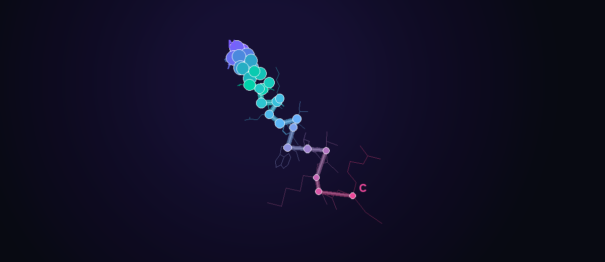

# Protein Lab

A structural-biology demo agent for [Omnigent](https://docs.databricks.com/aws/en/omnigent/) (Databricks' agent meta-harness): give it a sequence and it predicts the structure with [Boltz](https://github.com/jwohlwend/boltz), or loads an experimental structure from RCSB, then renders a still and a spin movie.

Independent demo by [Yossi Eliaz](https://zozo123.github.io/) built on Omnigent and Boltz; not an official Databricks or Boltz project. The Protein Lab session UI in the demo films is an animated mock ([`demo/omnigent_ui_mock.html`](demo/omnigent_ui_mock.html)); the Omnigent product shots in them are taken from the Databricks docs and omnigent.ai.



*GLP-1 (7–36), 30 residues, from a Boltz prediction: Cα ribbon and heavy-atom sticks, coloured N→C. Rendered by [`scripts/render_glp1_premium.py`](scripts/render_glp1_premium.py).*

```
sequence → Boltz (or RCSB demo) → still + spin movie
              ↑
     Omnigent agent (YAML + Python tools)
```

## Quick start (no API keys; downloads an experimental structure from RCSB, no prediction)

```bash
uv venv .venv && source .venv/bin/activate
uv pip install -e .

python -m demo.run_demo --target ubiquitin
open outputs/ubiquitin/ubiquitin_spin.mp4
```

## Live Boltz (GLP-1 story)

```bash
# boltz-api: https://install.boltz.bio/boltz-api/install.sh
boltz-api auth login   # or export BOLTZ_API_KEY=...

.venv/bin/python -m demo.run_boltz_e2e --input prediction-input-glp1.json
```

Input: `prediction-input-glp1.json` (GLP-1 7–36: `HAEGTFTSDVSSYLEGQAAKEFIAWLVKGR`).

## Omnigent agent

```bash
export PYTHONPATH=$PWD
omni run ./agents/protein-lab
# "Fold GLP-1 with Boltz and make a spin movie"
```

Agent config: `agents/protein-lab/config.yaml`  
Tools: `tools/protein_tools.py`

## Demo films

| Script | Output |
|--------|--------|
| `scripts/compose_28s_documentary.py` | ~28s documentary-style full story (structure-forward) |
| `scripts/compose_40s_full_story.py` | ~40s cut |
| `scripts/compose_straight_e2e.py` | short straight cut |

ElevenLabs VO needs `ELEVENLABS_API_KEY` in `.env` (gitignored).

```bash
.venv/bin/python scripts/compose_28s_documentary.py
open outputs/omnigent_boltz_glp1_28s.mp4
```

## Layout

```
agents/protein-lab/     Omnigent custom agent
tools/protein_tools.py  predict / render / movie / boltz-api
demo/                   offline + boltz runners, VO scripts
scripts/                film composers
prediction-input*.json  Boltz entity payloads
```

## Docs

- [Omnigent on Databricks](https://docs.databricks.com/aws/en/omnigent/)
- [omnigent.ai](https://omnigent.ai/)
- [Boltz](https://github.com/jwohlwend/boltz)

## License

Demo code: [MIT](LICENSE). Boltz, RCSB, Omnigent, and ElevenLabs have their own terms.
